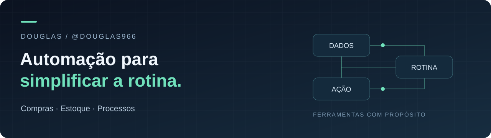

  

<h1 align="center">Olá, eu sou o Douglas.</h1>

  Meu foco é usar tecnologia para melhorar o trabalho na <strong>Banca 12</strong>. 
  Menos tarefas repetitivas. Mais clareza para decidir e agir.

---

### O que quero resolver

Tenho interesse em transformar necessidades da operação em ferramentas simples e úteis: organizar informações, reduzir trabalho manual e facilitar o acompanhamento da rotina.

| Compras | Estoque | Processos |
| :--- | :--- | :--- |
| Apoio à análise e ao planejamento de reposição. | Visibilidade de produtos e prioridades. | Automação de tarefas e organização de informações. |

### Meu portfólio está começando

Estou estruturando este espaço para apresentar projetos de automação e ferramentas voltadas ao trabalho. Os primeiros repositórios serão adicionados conforme houver algo para demonstrar.

Quero que cada projeto deixe claro:

- **O problema:** qual tarefa da rotina precisa melhorar.
- **A solução:** como a ferramenta ajuda quem usa.
- **O uso:** como executar e conferir o resultado.
- **O resultado:** o que mudou, com evidências quando disponíveis.

### Vamos conversar

Você pode acompanhar meus projetos e contribuições por aqui: [@douglas966](https://github.com/douglas966).

